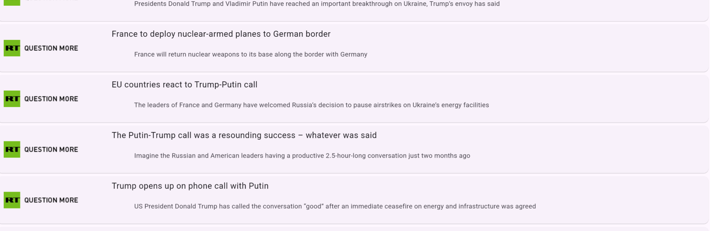
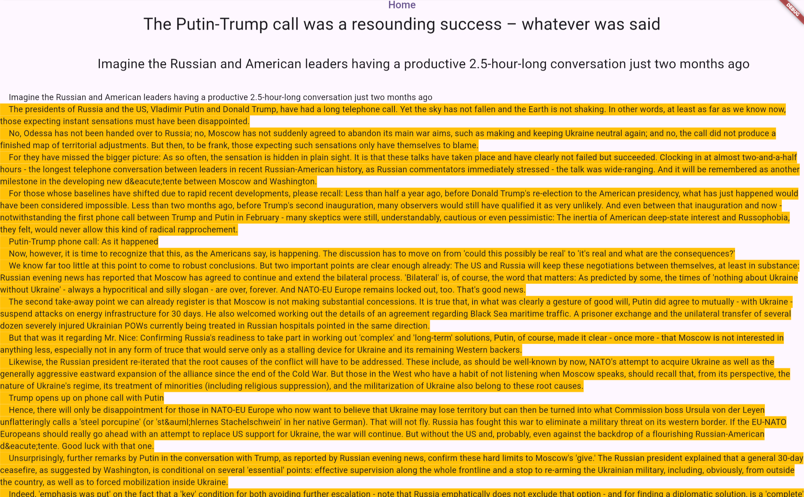
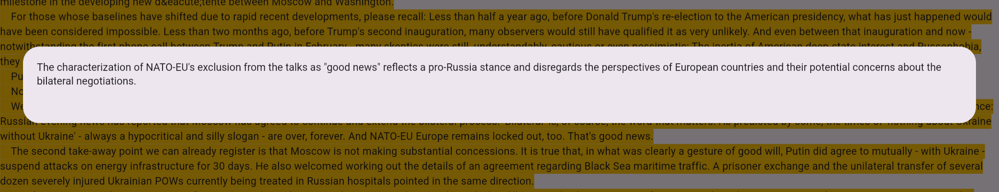
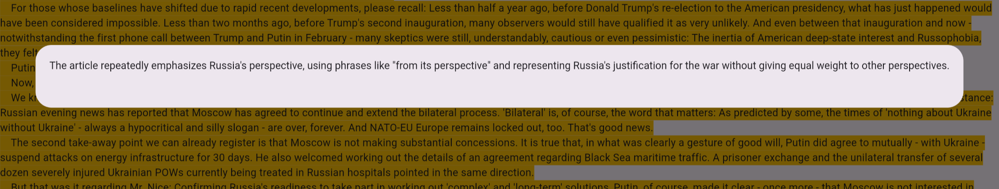
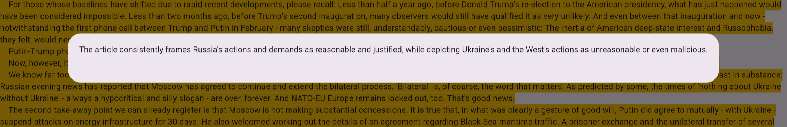

# Bias Detector App
Simple flutter app to highlight and annotate instances of possible bias in news articles using AI (Google Gemini). Click on a highlighted paragraph to see a popup with the possible bias annotation. Supported news platforms include RT News (Russia Today), Fox News, and Al Jazeera (in my opinion, the last one is far less biased, but it is still funded by the Qatari government). Completed for the Blueprint 2025 high school hackathon at MIT.

# Screenshots
### Example from RT News (on Linux)

